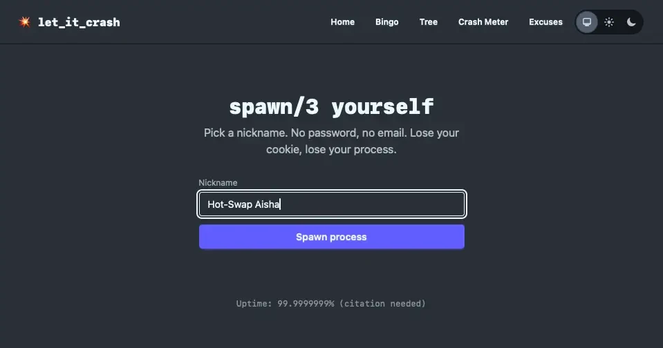
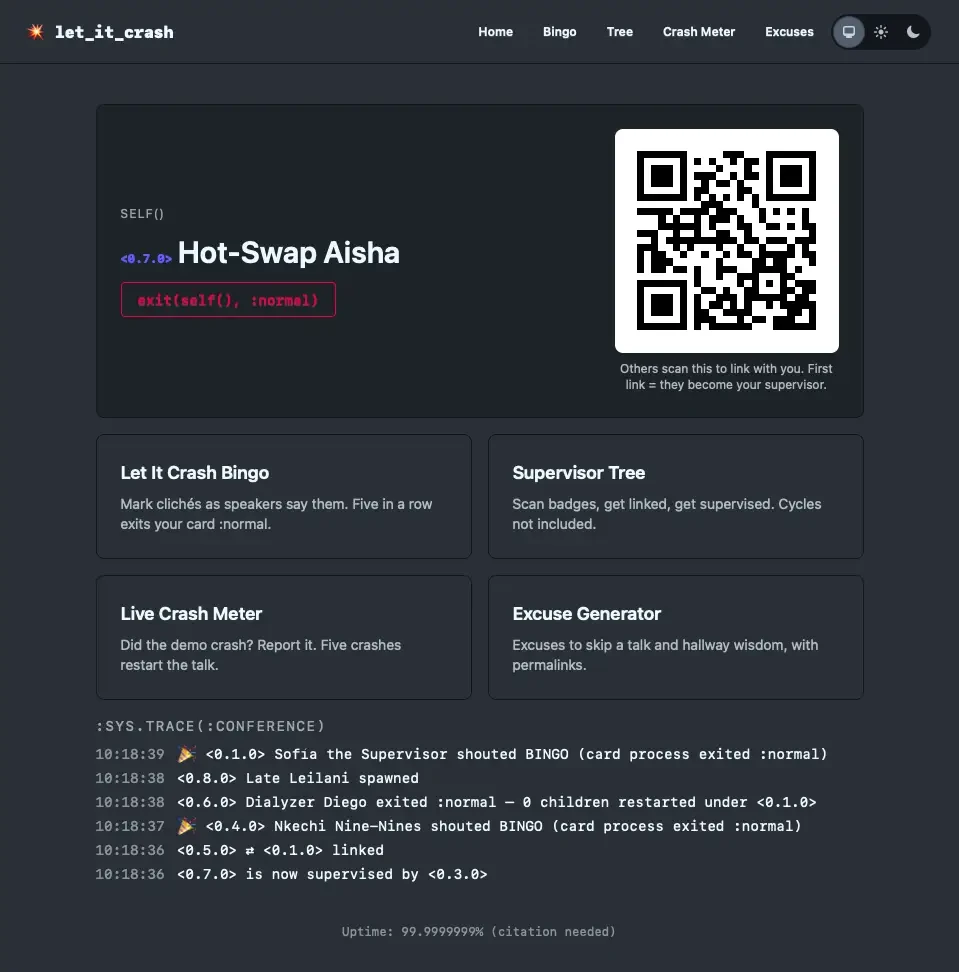
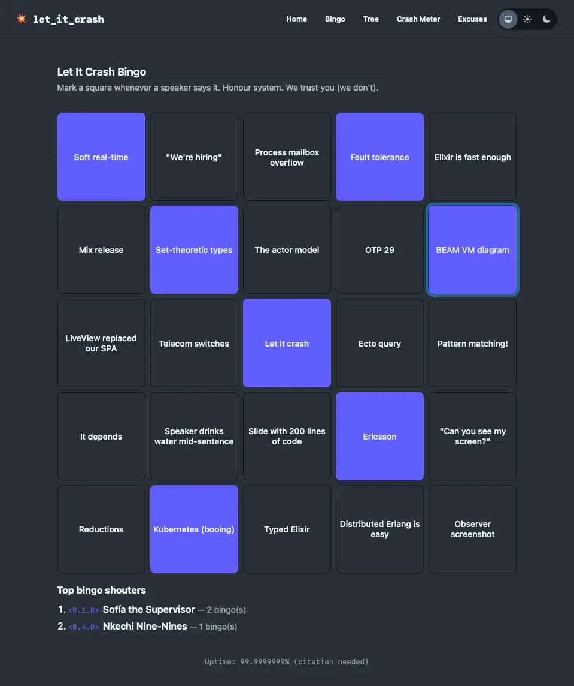
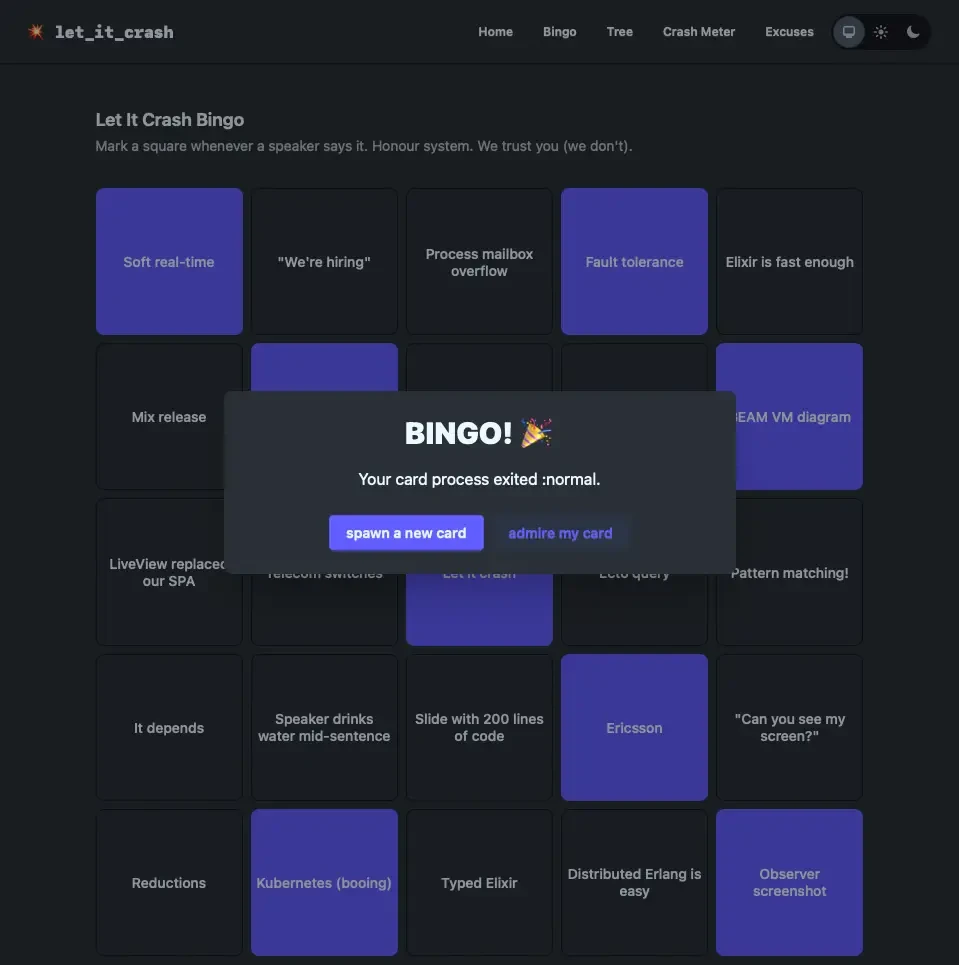
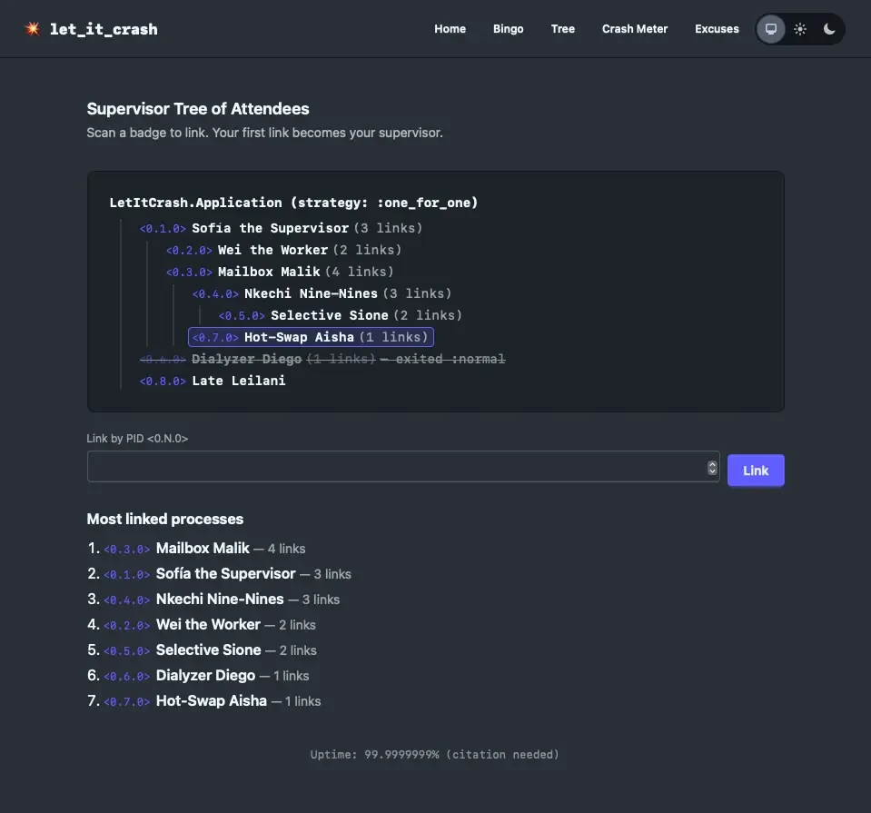
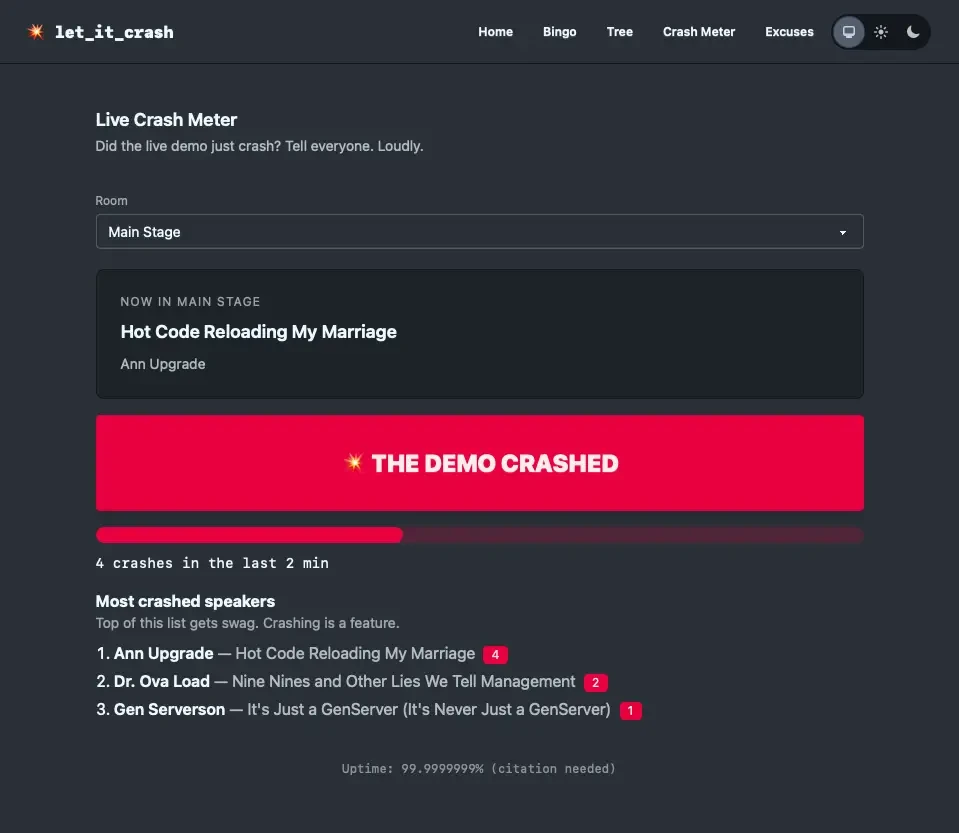
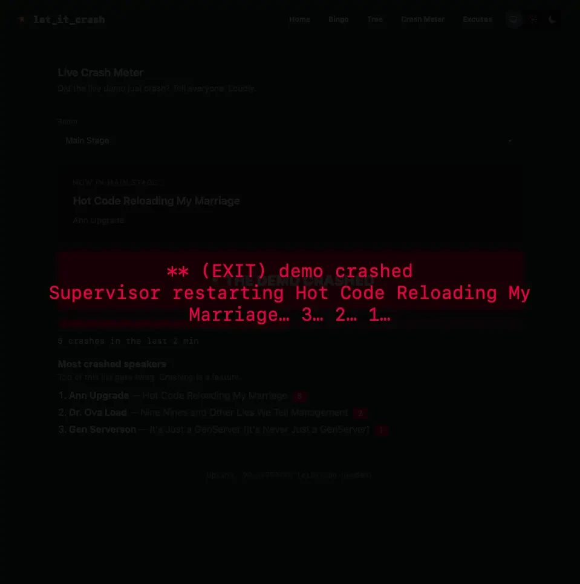
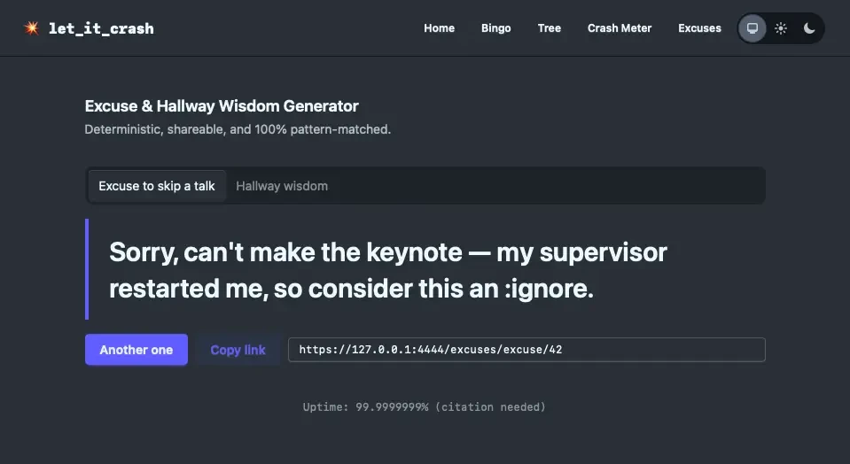
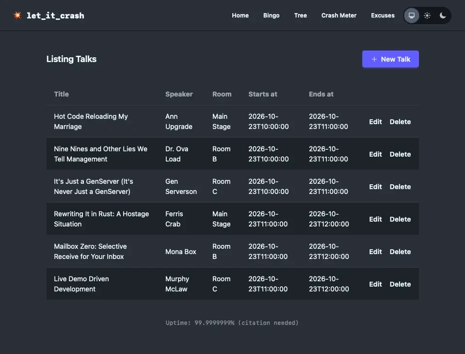

# Let It Crash — Code BEAM companion

Bingo, a supervisor tree of attendees, an excuse generator and a live crash meter.

Design and implementation plan: [`docs/plan.md`](docs/plan.md).

## Features

### Join and home

Pick a nickname and you're spawned as a process with a fake PID. Home shows your badge QR code (others
scan it to link with you), links to every feature and a live `:sys.trace` ticker of what's happening
at the conference.

 

### Let It Crash Bingo

A 5×5 card of conference clichés with "Let it crash" as the free square. A full row, column or
diagonal exits your card process `:normal` and puts you on the leaderboard.

 

### Supervisor Tree of Attendees

Scanning someone's badge links you. Your first link makes them your supervisor, unless that would
create a cycle. When someone exits, their children are restarted under their supervisor.

### Live Crash Meter

Pick your room and press the button when the live demo crashes. Five crashes within two minutes
trigger a supervisor restart of the talk on every screen in that room. The most crashed speakers get
a leaderboard.

 

### Excuse and hallway wisdom generator

Deterministic excuses to skip a talk, plus hallway wisdom. Every result has a shareable permalink.

### Admin

Password-protected talk schedule management at `/admin/talks`.

## Running locally

* `docker compose up -d` starts Postgres 18 on host port 5433
* `mkcert -install && mkdir -p priv/cert && mkcert -cert-file priv/cert/localhost.pem -key-file priv/cert/localhost-key.pem localhost 127.0.0.1 ::1`
  creates the locally-trusted certificate dev serves HTTPS with (once per machine; `priv/cert/` is gitignored)
* `mix setup` installs deps, creates/migrates the DB and seeds placeholder talks
* `mix phx.server`, then visit [`https://localhost:4000`](https://localhost:4000)
* `mix tunnel` (in a second terminal) exposes the dev server through a Cloudflare quick tunnel and
  prints a random `https://….trycloudflare.com` URL. Badge QR codes and permalinks use whichever
  host the visitor came in on.

Admin: [`/admin/talks`](https://localhost:4000/admin/talks) (basic auth, dev: `admin` / `letitcrash`;
prod: `ADMIN_USER` / `ADMIN_PASSWORD`). Talk times are wall-clock times in the conference time zone
(`:conference_time_zone`, default `Europe/Berlin`).

## Learn more

* Official website: https://www.phoenixframework.org/
* Guides: https://phoenix.hexdocs.pm/overview.html
* Docs: https://phoenix.hexdocs.pm
* Forum: https://elixirforum.com/c/phoenix-forum
* Source: https://github.com/phoenixframework/phoenix
